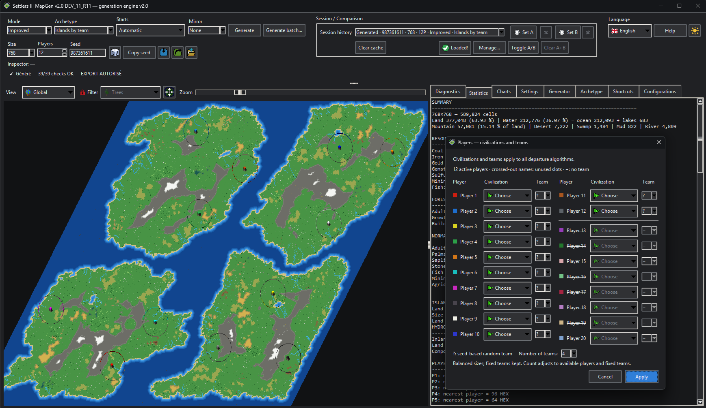
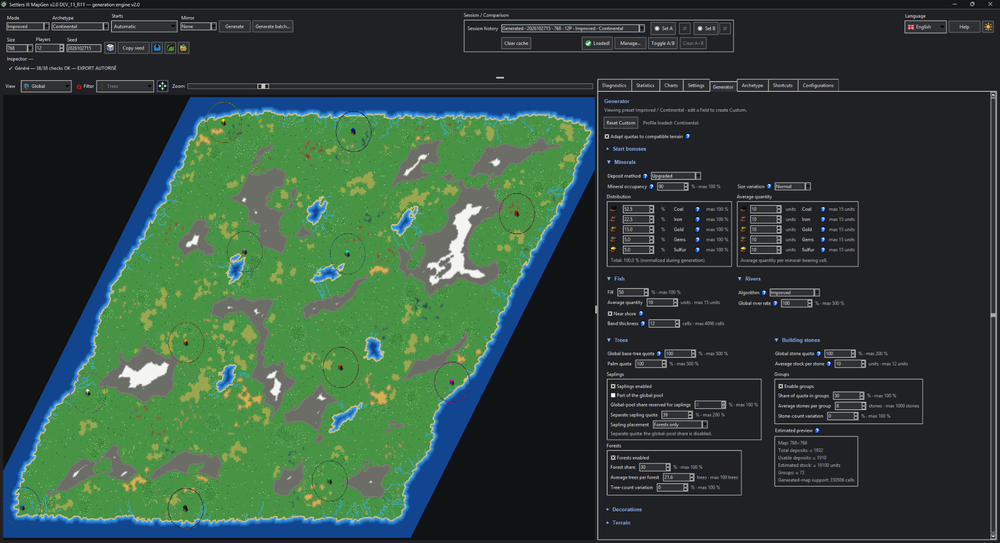
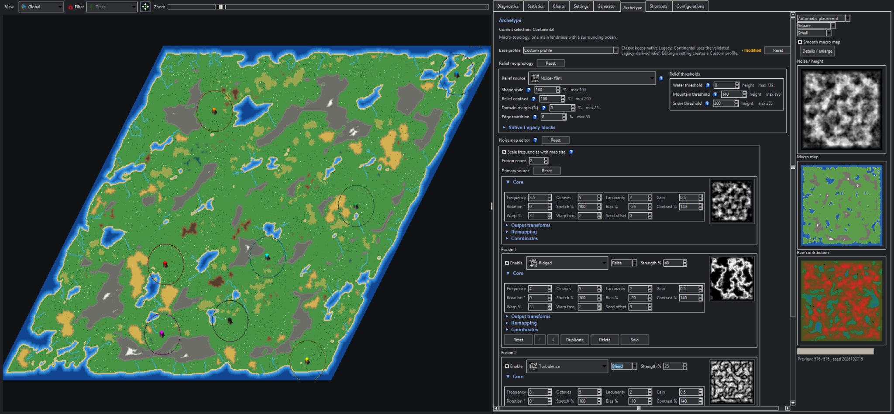
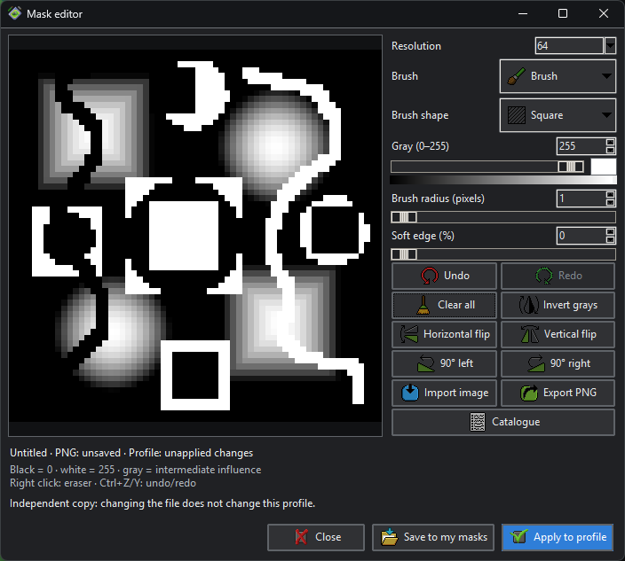
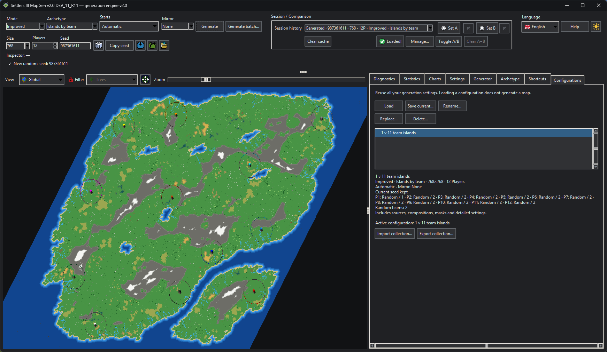
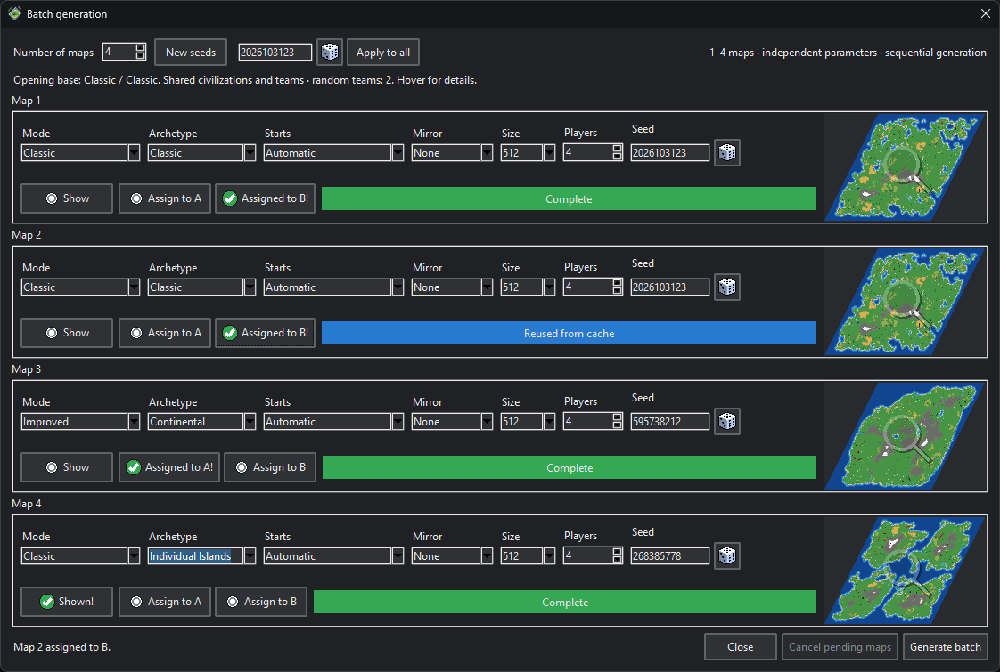
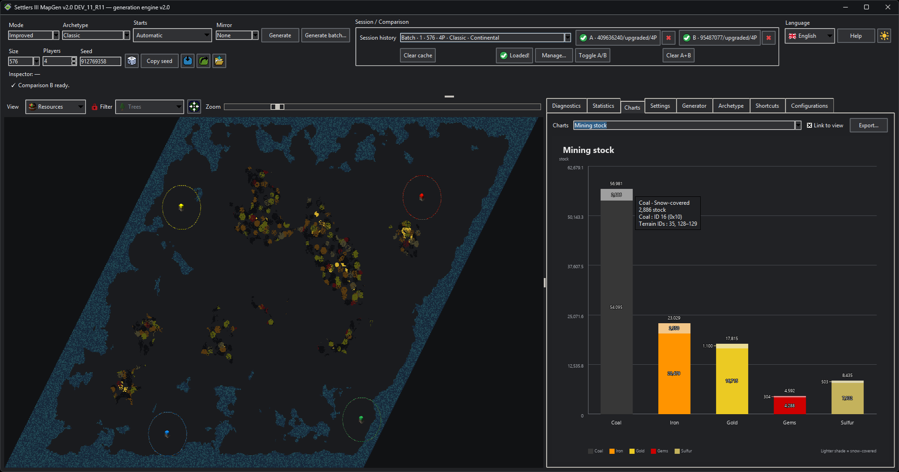

# Settlers III MapGen

**Français** · [English](README_EN.md)

Générateur et outil d’analyse de cartes pour **The Settlers III** : cartes reproductibles, réglages de génération et de relief, import `.EDM` / `.MAP` / `.SAV`, inspection et export natif.

**État : 2.0 DEV_11, checkpoint de développement validé.** La 2.0 STABLE n’est pas encore publiée. Le portable R15 a été construit, qualifié et accepté sous Windows ; la CI reconstruit le checkpoint complet avant publication.

Le projet est conçu, dirigé, testé et validé par son propriétaire, avec une assistance importante de **ChatGPT / OpenAI** pour l’implémentation, notamment le backend, l’analyse technique et les outils de rétro-ingénierie. Les dessins et sprites fournis par le propriétaire sont conservés ; les cartes affichées sont des rendus déterministes de données réelles. Aucun visuel de carte fictif n’est utilisé.

## Générer une carte

1. Choisir le **mode** : Classique, Amélioré ou Personnalisé.
2. Choisir l’**archétype** : Classique, Continental, Îles individuelles ou Îles par équipe.
3. Régler taille, joueurs, civilisations, équipes, algorithme de départ et seed.
4. Générer, inspecter la carte et ses diagnostics, puis exporter en `.EDM` ou `.MAP`.

Le mode **Classique** conserve le moteur natif de référence ; **Amélioré** propose ses propres réglages et passes de contenu. **Personnalisé** permet d’ajuster minerais, poissons, rivières, terrains, arbres, pierres, décors et bonus de départ.

L’archétype est un choix indépendant : **Classique** conserve la géographie native ; **Continental** utilise une masse terrestre moderne avec relief réparti et lacs intérieurs ; les compositions insulaires répartissent les îles par joueur ou par équipe. Les équipes peuvent être manuelles, indépendantes (`−`) ou aléatoires (`?`, nombre d’équipes réglable).

*Carte réelle Amélioré, 768×768, 12 joueurs et quatre équipes aléatoires. Le dialogue présente les choix de civilisations et d’équipes.*

## Personnaliser générateur et relief

Les onglets **Générateur** et **Archétype** séparent le contenu de la carte de sa composition géographique. Les choix standards sont des presets ; modifier leurs réglages fait apparaître Personnalisé dans le sélecteur correspondant.

Les sources de relief peuvent être combinées et transformées, avec aperçus Bruit/hauteur, Carte macro et Contribution brute. Les formules appliquées et les masques font partie de la configuration enregistrée. L’éditeur de masques propose dessin en niveaux de gris, import, transformations et catalogue personnel.

Voir les réglages et l’éditeur de masques

[Masques et éditeur](docs/USER_MASKS.md) · [Relief insulaire](docs/ISLAND_RELIEF.md) · [Sprites fournis](docs/SPRITES.md)

## Conserver ses configurations

L’onglet **Configurations** enregistre le paramétrage complet : génération, archétype, sources et masques, taille, joueurs, civilisations, équipes, départs et miroir. Inclure le seed est facultatif. Charger une configuration ne génère pas de carte.

La collection s’enregistre automatiquement dans le dossier utilisateur. Import et export utilisent un seul JSON avec les grilles de masque embarquées ; les conflits de noms à l’import créent des copies sans écraser les entrées existantes.

[Contenu des configurations et format d’échange](docs/CONFIGURATIONS.md)

## Explorer des seeds et variantes par lots

La génération par lots compare rapidement **une à quatre cartes**, avec seed, mode, archétype, départs, miroir, taille et joueurs réglables par ligne. Elle génère les cartes successivement et permet d’afficher un résultat ou de l’affecter à la comparaison A/B.

Les réglages détaillés, civilisations et équipes sont copiés à l’ouverture ; un résumé commun indique leur origine. **Personnalisé** est proposé séparément pour le générateur et l’archétype uniquement si ce choix était actif à l’ouverture. Choisir une variante standard puis revenir à Personnalisé retrouve la copie initiale, sans modifier la fenêtre principale. Il n’y a pas quatre éditeurs de profils indépendants.

Voir un lot et ses résultats

*Capture Windows R13 : quatre cartes, résumé des réglages communs, réutilisation du cache et affectations A/B. Les deux premières lignes partagent le même résultat mis en cache, affecté à B.*

[Contrat des lots et réglages communs](docs/BATCH_GENERATION.md)

## Analyser et comparer

Les vues comprennent carte globale, relief, ressources, territoires et départs valides. Statistiques et Graphiques décrivent les données de la carte affichée ; la session permet historique, cache et comparaison A/B. **Diagnostic** regroupe Validations, Pipeline et Métadonnées.

*Analyse d’un résultat de lot : stocks miniers et part recouverte par la neige. Captures Windows fournies par le propriétaire : DEV11 R11, sauf la fenêtre de lots en R13.*

Le filtre des départs distingue les règles de l’éditeur et du jeu. Une position jouable peut être refusée par l’éditeur ; les indications et diagnostics ne remplacent pas un essai dans le logiciel cible. L’algorithme de départ **Classique** reste distinct du mode de génération Classique.

## Formats et limites

- Tailles natives : **256 à 768**, par pas de 64. Maximum **768×768** ; les tailles supérieures ne sont pas proposées. Le nombre de joueurs est limité selon la taille, jusqu’à 20.
- Les petites tailles natives restent utilisables pour les essais ; leur génération ne garantit pas une partie économiquement viable.
- Import EDM/MAP et lecture SAV ; export EDM/MAP. La conversion d’une sauvegarde en nouvelle carte reprend les données prises en charge, sans reconstituer les bâtiments, unités ou événements d’une partie en cours. Le SAV source reste intact.
- Aucun mode éditeur complet, replay ou Stats 2 livré. Ces travaux et les nouveaux archétypes restent hors 2.0.
- Les validations automatiques sont des garde-fous : elles ne remplacent pas les essais Windows, éditeur et jeu.

[Départs et équipes](docs/PLAYER_STARTS.md) · [Contrat des imports/exports](docs/MAP_EXPORT.md) · [Travail restant](TODO_MAPGEN.md)

## Lancer sous Windows

**Portable :** lorsqu’un ZIP Windows est publié dans les [Releases GitHub](https://github.com/JulienP36/settlers3-mapgen/releases), le décompresser entièrement et lancer `Settlers3MapGen.exe`. Conserver `_internal` à côté de l’exécutable. Aucune installation de Python ni téléchargement de dépendances n’est nécessaire pour ce paquet. Le portable de recette R15 a été qualifié sous Windows ; le paquet public final portera la version 2.0 STABLE.

**Sources :** avec Python installé, lancer `install_and_run.bat` pour installer les dépendances, puis `run_gui.bat` pour les lancements suivants. Si Python manque, `install_python_and_run.bat` peut installer Python 3.12 via winget. Ces scripts concernent les sources, pas le portable.

Préférences, configurations et masques personnels restent dans `%APPDATA%/Settlers3MapGen`. Les exports par défaut sont dans `output/`, à côté du programme. Fermer l’ancienne version avant d’ouvrir la suivante ; conserver ses exports avant de supprimer son dossier.

Les nouvelles versions se téléchargent **manuellement**. L’application ne vérifie, ne télécharge et n’installe pas de mise à jour.

[Conservation des données utilisateur](docs/USER_DATA.md) · [Lanceurs source](docs/WINDOWS_LAUNCHERS.md) · [Construction du portable](build/windows/BUILD_WINDOWS.md)

## Développement et références

Dépendances principales : NumPy, SciPy, Pillow et Tkinter. Depuis les sources : `python run_gui.py`. L’auto-test de ressources se lance avec `python run_gui.py --self-test` ; la suite avec `python -m pytest` (les essais Tk nécessitent un affichage).

- [Architecture](docs/ARCHITECTURE.md) et [diagnostic](docs/DEBUGGING.md).
- [Consignes du dépôt](AGENTS.md), [workflow](PROJECT_WORKFLOW.md), [changelog](CHANGELOG.md) et [publication GitHub](docs/GITHUB_PUBLICATION.md).
- Le dossier de recherche/reprise `references/` est inclus dans les ZIP sources de transmission et exclu du dépôt public courant.

Dans les ZIP de reprise : `references/REFERENCE_INDEX.md` et `references/SETTLERS3_UPGRADED_RULE_MATRIX_CURRENT.md`.
