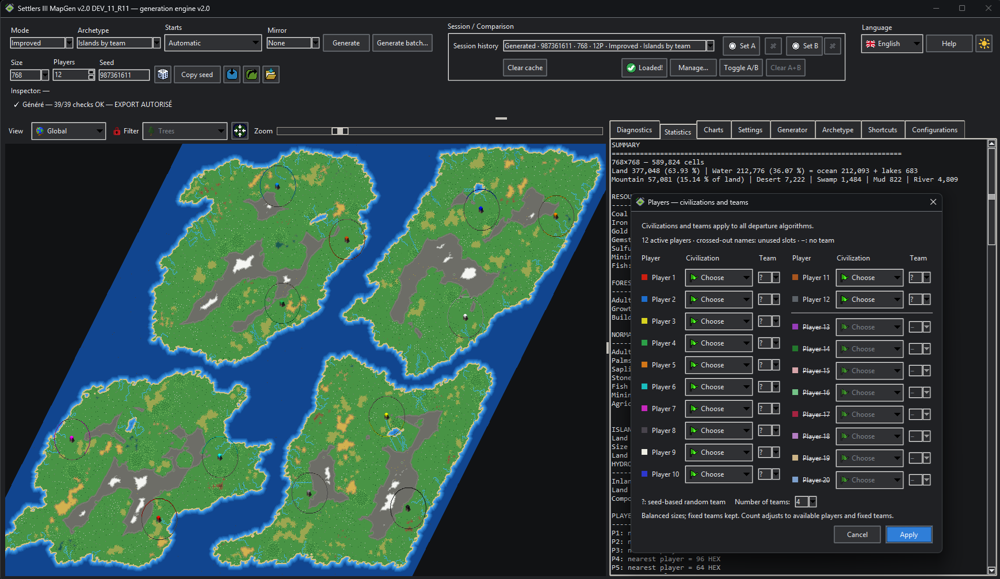
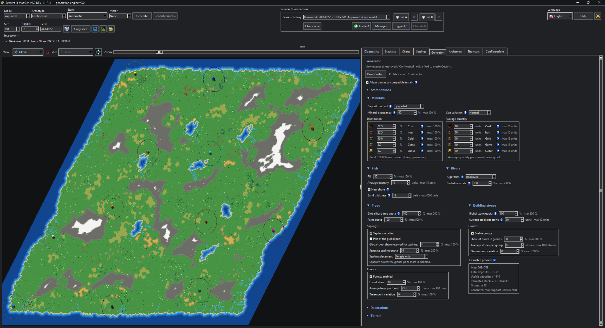
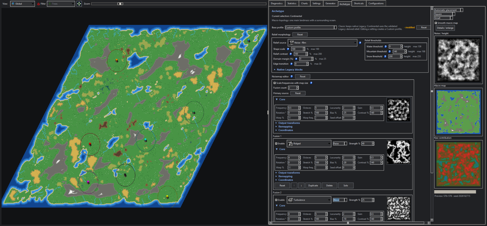
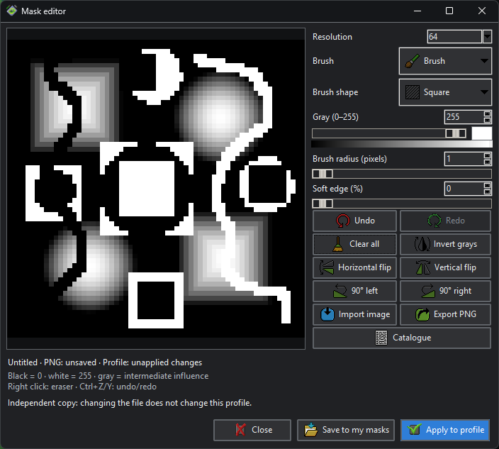
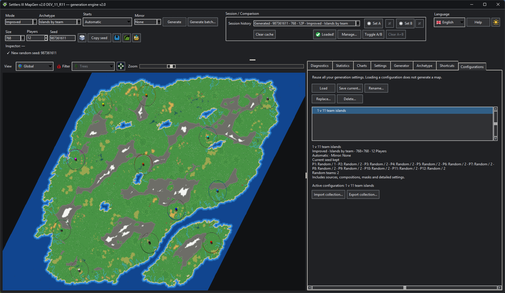
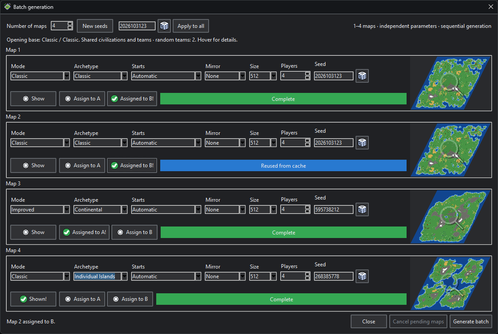
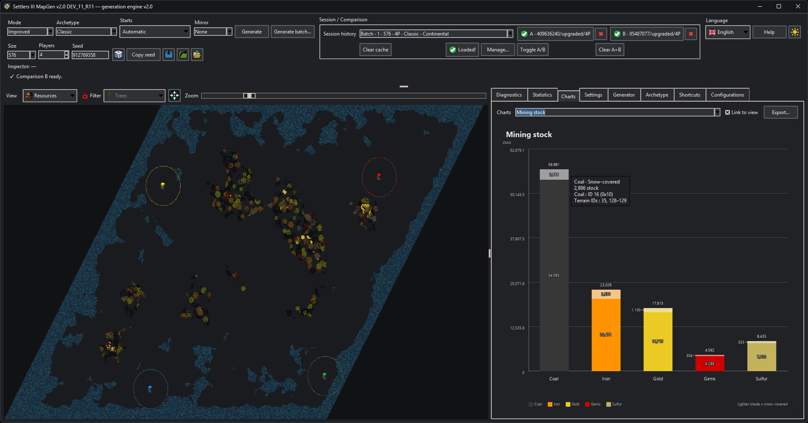

# Settlers III MapGen

[Français](README.md) · **English**

A reproducible map generator and analysis workbench for **The Settlers III**, with generation and relief controls, `.EDM` / `.MAP` / `.SAV` import, inspection and native map export.

**Version: 2.0 STABLE.** [Downloads and release notes](https://github.com/JulienP36/settlers3-mapgen/releases/tag/v2.0): source archive and Windows x64 portable. The portable requires no Python installation or dependency downloads.

The project is conceived, directed, tested and validated by its human owner, with substantial **ChatGPT / OpenAI implementation assistance**, especially for backend development, technical analysis and reverse-engineering tools. Owner-supplied drawings and sprites are preserved. Map previews are deterministic renderings of real data; no invented map artwork is used.

## Generate a map

1. Select a **mode**: Classic, Improved or Custom.
2. Select an **archetype**: Classic, Continental, Individual Islands or Islands by Team.
3. Choose size, players, civilizations, teams, start algorithm and seed.
4. Generate, inspect the map and its diagnostics, then export `.EDM` or `.MAP`.

**Classic** retains the reference native engine. **Improved** provides its own settings and content passes. **Custom** exposes minerals, fish, rivers, terrain, trees, stones, decorations and start bonuses.

Archetype selection is independent: **Classic** keeps native geography; **Continental** uses a modern landmass with distributed relief and interior lakes; island compositions distribute islands by player or team. Teams can be assigned manually, independent (`−`) or random (`?`, with an adjustable team count).

*An actual Improved 768×768 map with 12 players and four random teams. The dialog shows civilization and team choices.*

## Customize generation and relief

The **Generator** and **Archetype** tabs separate map content from its geographical composition. Standard choices are presets; changing their settings exposes Custom in the corresponding selector.

Relief sources can be combined and transformed, with Noise/height, Macro map and Raw contribution previews. Applied formulas and masks are part of saved configurations. The mask editor supports grayscale drawing, image import, transformations and a personal catalogue.

Show settings and the mask editor

[Masks and editor](docs/USER_MASKS.md) · [Island relief](docs/ISLAND_RELIEF.md) · [Supplied sprites](docs/SPRITES.md)

## Save configurations

The **Configurations** tab saves complete generation settings: generator, archetype, sources and masks, size, players, civilizations, teams, starts and mirror. Including the seed is optional. Loading a configuration does not generate a map.

The collection is saved automatically in the user-data folder. Import and export use one JSON file with embedded mask grids; conflicting imported names create additional copies without replacing existing entries.

[Configuration contents and exchange format](docs/CONFIGURATIONS.md)

## Explore seeds and variants in batches

Batch generation compares **one to four maps**, with seed, mode, archetype, starts, mirror, size and player count adjustable per row. Maps are generated sequentially; each result can be displayed or assigned to comparison A/B.

Detailed settings, civilizations and teams are copied when the window opens; a common summary states their origin. **Custom** is available separately for generator and archetype only when that choice was active on opening. Selecting a standard variant and returning to Custom restores the opening copy without modifying the main editor. The batch window does not contain four independent profile editors.

Show a batch and its results

*R13 Windows capture: four maps, shared settings summary, cache reuse and A/B assignments. The first two rows share the same cached result, assigned to B.*

[Batch settings and shared configuration contract](docs/BATCH_GENERATION.md)

## Analyze and compare

Views include the global map, heightmap, resources, territories and valid starts. Statistics and Charts describe the displayed map; session tools provide history, cache and A/B comparison. **Diagnostics** groups Validations, Pipeline and Metadata.

*Analysis of a batch result: mineral stock and its snow-covered share. Windows screenshots supplied by the owner use DEV11 R11, except for the R13 batch window.*

The valid-start filter distinguishes editor rules from game rules. A playable position can be rejected by the editor; indicators and diagnostics do not replace testing in the target software. The **Classic start algorithm** is separate from Classic generation mode.

## Formats and limits

- Native sizes: **256 to 768**, in steps of 64. Maximum **768×768**; larger sizes are not offered. Player count is limited by map size, up to 20.
- Small native sizes remain available for experiments; generation does not guarantee economically viable gameplay at those sizes.
- EDM/MAP import and SAV reading; EDM/MAP export. Save-to-new-map conversion retains supported data without reconstructing buildings, units or events from an ongoing game. The source SAV remains intact.
- No full map-editor mode, replay or Stats 2 is delivered. Those features and additional archetypes remain outside 2.0.
- Automated validation provides regression safeguards, not a substitute for Windows, editor and in-game tests.

[Starts and teams](docs/PLAYER_STARTS.md) · [Import/export contract](docs/MAP_EXPORT.md) · [Remaining work](TODO_MAPGEN.md)

## Run on Windows

**Portable:** when a Windows ZIP is available in [GitHub Releases](https://github.com/JulienP36/settlers3-mapgen/releases), extract it fully and run `Settlers3MapGen.exe`. Keep `_internal` beside the executable. This package needs no Python installation or dependency downloads. The R15 acceptance portable was approved on Windows; the final package is rebuilt and qualified from the 2.0 STABLE commit.

**Sources:** with Python installed, run `install_and_run.bat` to install dependencies, then use `run_gui.bat` for later launches. If Python is missing, `install_python_and_run.bat` can install Python 3.12 through winget. These scripts are for the sources, not the portable.

Preferences, configurations and personal masks remain in `%APPDATA%/Settlers3MapGen`. Default exports are in `output/` beside the program. Close the old version before opening a new one; retain its exports before deleting its folder.

New versions are downloaded **manually**. The application does not check for, download or install updates.

[User-data retention](docs/USER_DATA.md) · [Source launchers](docs/WINDOWS_LAUNCHERS.md) · [Portable build](build/windows/BUILD_WINDOWS.md)

## Development and references

Main dependencies: NumPy, SciPy, Pillow and Tkinter. From sources: `python run_gui.py`. Run the resource self-test with `python run_gui.py --self-test`; run tests with `python -m pytest` (Tk tests require a display).

- [Architecture](docs/ARCHITECTURE.md) and [debugging](docs/DEBUGGING.md).
- [Repository instructions](AGENTS.md), [workflow](PROJECT_WORKFLOW.md), [changelog](CHANGELOG.md) and [GitHub publication](docs/GITHUB_PUBLICATION.md).
- The research/recovery `references/` directory is included in source hand-off ZIPs and excluded from the current public Git tree. Some specialist documents are in French.

Research ZIP entrypoints: `references/REFERENCE_INDEX.md` · `references/SETTLERS3_UPGRADED_RULE_MATRIX_CURRENT.md`.
